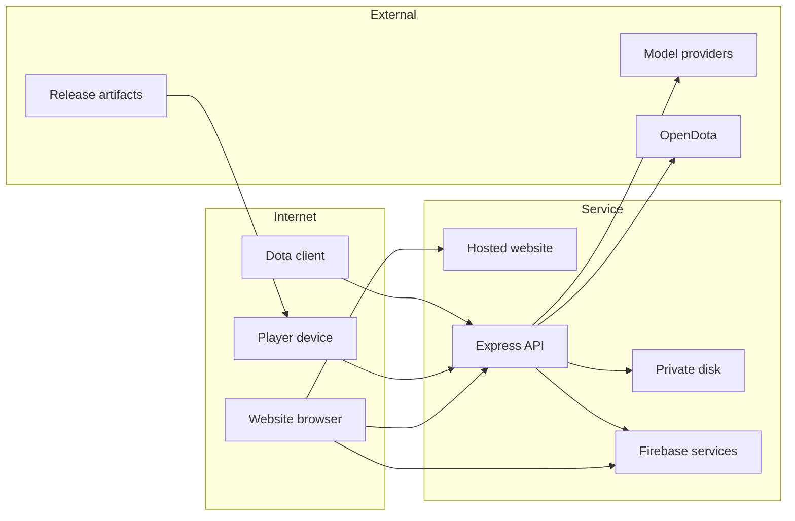

## Executive summary

Reviewed 17 November 2026 for the confirmed public website/API deployment. ArenaHub's main residual risks are trusting player-controlled telemetry, native release authenticity, and unverified host storage/ingress controls. This pass fixed telemetry-token scope, misleading liveness, recording-policy bypass, unsafe pairing destinations, public-host integration and several browser/native defaults. This repository-grounded model supports the implementation work; it is not an external penetration-test certification.

## Scope and assumptions

Includes `src/`, `server/`, `api/`, Firebase rules, native companions and release tooling. The user confirmed public hosting and Windows/iPhone availability; physical Android testing is deferred. Assumes one institution, trusted tournament staff, Firebase identities, and one persistent HTTPS Node API with private disk. No deployed host, DNS, IAM, secret manager, publisher server or player OS was independently audited. Live cheats were not acquired or executed.

Open questions: hosting provider/domain and ingress topology; release-signing ownership; concurrent audience/player count and storage budget. These affect availability and distribution risk. The user resolved the main context question to public hosting, rather than a player-only event-laptop tunnel.

## System model

### Primary components

- React/Vite UI and standalone player join page (`src/main.tsx`, `public/join.html`).
- Firebase Auth, Firestore and evidence Storage with private/public rules (`src/lib/firebase.ts`, `firestore.rules`, `storage.rules`).
- Express APIs and shared account/staff verification (`server/app.ts`, `server/auth.ts`). The serverless entry disables the disk-backed monitor (`api/index.ts`).
- Stateful monitor, SQLite and private recordings (`server/integrity.ts`, `server/integrityStore.ts`).
- Windows user-mode agent and Android companion; iPhone browser check-in (`tools/integrity-agent/`, `companion/android/`, `public/join.html`).
- External model providers and fixed OpenDota API. Build/test tools and native release artifacts are separate from production runtime.

### Data flows and trust boundaries

- Internet browser -> website: HTTPS HTML/JS, URL/code inputs and native links; production CSP/embedding headers, React text rendering and normalized pairing origins. TLS termination is a host responsibility (`server/securityPolicy.mjs:15`, `src/lib/monitorAddress.ts:2`).
- Browser -> Firebase: identity tokens, profiles, tournament/chat/registration/case/file records; Auth and rules enforce admission, staff and private boundaries. Deployed rules remain unverified (`firestore.rules`, `storage.rules`).
- Staff browser -> Express: bearer tokens, settings, model requests and session/media reads; identity/active-staff checks, CORS allowlist, schemas/body limits and generic errors (`server/auth.ts:49`, `server/cors.ts`, `server/integrity.ts:210`).
- Player -> monitor: one-use code, then scoped device token, bounded facts and media. Tokens are hashed at rest; expiry, recording policy and throttles apply. Hosted origins and the standard APK require HTTPS. Facts are self-reported, not attested (`server/integrity.ts:53`, Android `Api.kt`).
- Dota -> monitor: game context and separate telemetry-only token; limited body/schema, scope and throttling. GSI is not a scanner-liveness source (`server/integrity.ts:189`).
- Monitor -> private disk: prepared SQLite statements and generated media paths; host permissions, encryption/backups, quotas and retention ownership are external controls (`server/integrityStore.ts`).
- API -> model/OpenDota: configured secrets and filtered match/case/frame context over provider HTTPS; OpenDota destination is fixed and IDs constrained. Model output is untrusted and sparse frames do not establish installed cheats (`server/fairPlay.ts`, `server/ai/caseSummary.ts`).
- Maintainer -> release -> player OS: dependencies/config/source become JS/APK/EXE; production checks compare configured secret values and reject demo artifacts, but organization-controlled native signing is absent (`scripts/check-production-build.mjs`, native build scripts).

#### Diagram

## Assets and security objectives

| Asset | Why it matters | Security objective |
|---|---|---|
| Staff identity and server keys | Authorizes private reads, publication, moderation and model spending | C I |
| Tournament and case records | Incorrect results/decisions harm players and event trust | I A |
| Device reports, Steam IDs and captures | Device details and private on-screen content may be sensitive | C I |
| Pairing/device/GSI/playback capabilities | Grant scoped reporting/control/media access | C I |
| Compute, model quota and private disk | Public abuse can make the event unavailable or expensive | A |
| Native artifacts | Players execute them with their own device privileges | I |

## Attacker model

### Capabilities

A remote visitor can send malformed/repeated requests, guess codes and fetch public artifacts. A student can use their own ordinary account token. A paired player can control their OS, alter the collector, fabricate reports and submit allowed media. A compromised staff account can exercise staff privileges. A compromised release/dependency channel can alter executable artifacts.

### Non-capabilities

An ordinary remote visitor cannot mint verified staff claims, bypass correctly deployed private rules, read the private volume or decrypt TLS traffic without a separate compromise. ArenaHub has no publisher anti-cheat internals. Browser/iPhone check-in cannot reliably enumerate installed cheats. No publisher RCE, kernel exploit or cross-institution tenancy was established.

## Entry points and attack surfaces

| Surface | How reached | Trust boundary | Notes | Evidence |
|---|---|---|---|---|
| Website/join | Public HTTPS | Internet to browser | URL/code/native links and CSP | `public/join.html`, `monitorAddress.ts` |
| Firebase data/files | SDK or direct API | Account to data | Profiles, roles, drafts, chat, tournaments, cases | `firestore.rules`, `storage.rules` |
| AI/Fair Play | Authenticated HTTP | Browser to privileged API/provider | Admission/staff checks, model limits, scrubbed digest | `server/ai.ts`, `server/fairPlay.ts` |
| Pair/claim/decline | Public HTTP | Player to session | Expiring one-use code; possession is not identity | `server/integrity.ts` |
| Heartbeat/media/chunks | Device token | Untrusted device to server/disk | Self-reports, caps and recording policy | `server/integrity.ts:136` |
| Dota GSI | Telemetry token | Game to monitor | Scoped context, not a cheat detector | `server/integrity.ts:189` |
| Settings/review/media | Staff token or playback ticket | Staff to private evidence | Staff policy and short-lived single-file capability | `server/integrity.ts:210` |
| Native release/execution | Build/download | Maintainer to player OS | Read-only observations and optional capture; signing pending | Native sources/build scripts |

## Top abuse paths

1. Player pairs -> replaces collector or fabricates an empty report -> staff infer clean play -> cheating goes undetected. Coverage warnings and independent observation reduce misinterpretation; user-mode reporting cannot eliminate this path.
2. Attacker obtains pairing code -> claims it first -> submits misleading identity/facts -> wrong device monitored. Expiry/single use/throttles help; private delivery and staff identity confirmation remain necessary.
3. Paired device uploads permitted chunks across sessions -> private disk fills -> event monitoring fails. Body/per-session limits help; global quotas and ingress concurrency limits remain host work.
4. Visitor/student guesses private record/media IDs -> calls privileged paths -> attempts evidence disclosure. Shared active-staff checks, private rules, generated paths and playback capabilities block tested requests.
5. Content author supplies executable markup or a crafted pairing destination -> seeks staff-token theft or a malicious copied command -> compromises tournament/device integrity. Safe text rendering, strict DNS/IP origins, fixed templates and CSP constrain reviewed paths.
6. Release/dependency channel is compromised -> modified APK/EXE is served -> players execute it -> device compromise. Controlled test distribution, signatures and trusted-channel fingerprints are necessary.
7. Compromised staff/model context -> discloses private case material or treats model output as guilt -> privacy/unfair-decision harm. Scrubbed digests, constrained outputs and human decisions reduce exposure; external account settings remain unverified.

## Threat model table

| Threat ID | Threat source | Prerequisites | Threat action | Impact | Impacted assets | Existing controls (evidence) | Gaps | Recommended mitigations | Detection ideas | Likelihood | Impact severity | Priority |
|---|---|---|---|---|---|---|---|---|---|---|---|---|
| TM-001 | Paired player | Controls OS/client | Forges or suppresses reports | Undetected cheating or unreliable findings | Match/case integrity | Coverage labels, server policy revalidation, local deadlines, human review (`integrityRisk.ts`, native agents) | No attested truth source | Staff-controlled devices, publisher controls and independent observers | Correlate gaps, POV/replay, GSI and observation | high: client control is realistic | high: incorrect competitive decisions | high |
| TM-002 | Code thief/player | Possesses code or leaked capability | Claims another pairing or misuses token scope | Wrong device or misleading context | Tokens/evidence | One-use expiry, hashed tokens, separate GSI scope, revocation, playback limits (`integrityStore.ts:101`) | Possession is not identity; links can leak | Private code delivery and player/device confirmation | Review claim/audit times and identity mismatch signals | medium: possession/race needed | high: targeted evidence integrity | medium |
| TM-003 | Visitor/uploader | Public reachability; token for useful uploads | Floods parser/model/media resources | Outage, quota exhaustion or full disk | Availability/cost | Body limits, bounded throttles, GSI limit, per-session cap, model limits (`integrity.ts`, `ai.ts`) | No replica coordination/global disk quota; ingress unverified | One persistent monitor process, edge concurrency limits, disk quotas/alerts and load test | Track aggregate 429/413/507, disk and provider quotas | medium: public but useful uploads need token | high: event-wide disruption | high |
| TM-004 | Visitor/student | Network or ordinary token | Attempts role/private-record access | Evidence disclosure or unauthorized decisions | Identity/cases/records | Verified active staff, revocation-aware Admin path, negative rules tests (`auth.ts:49`, rules) | Deployment/IAM unverified; stolen staff remains privileged | Verify deployed rules/IAM/domains, protect sign-in and revoke compromise | Trusted role-change/case audit records | low: tested checks still require staff authority | high: private data and decisions | medium |
| TM-005 | Content author | Can supply rendered text or pairing input | Attempts browser/config/command injection | Staff/device compromise | Credentials/records | JSX/textContent, strict DNS/IP origin, GSI template, exact script hashes (`monitorAddress.ts:2`, `securityPolicy.mjs`) | CSP is partial defense; live auth/embed environment unverified | Preserve safe rendering, verify actual hosted CSP/auth/embeds | CSP violations without token-bearing URLs | low: reviewed executable paths constrained | high: credential/device compromise | medium |
| TM-006 | Staff/service compromise | Authorized or host/provider access | Leaks or over-retains captures/context | Privacy harm | Reports/captures/keys | Staff checks, minimization, recording gate, private paths, cleanup/holds, scrubbed digest | Backups/key management/hold release unverified | Private encrypted volume/backups, least-privilege keys, retention ownership | Audit holds/access and aggregate retention metrics | medium: operational access exists | high: captures may be sensitive | high |
| TM-007 | Release attacker | Controls build/artifact channel | Distributes malicious collector | Player device compromise | Native artifacts/player trust | Lockfile, build secret/demo checks, explicit consent, read-only design | No valid EXE release signature; development APK key | Review/sign releases, trusted fingerprints, device validation | Compare approved manifest and release signatures | medium: depends on channel compromise | high: native execution | high |

## Criticality calibration

Critical means an established broad auth bypass or pre-auth execution exposing all private evidence; forged admin authority accepted from an ordinary user would qualify too. Neither was demonstrated.

High covers forged telemetry producing invalid competitive decisions, private capture disclosure through hosting compromise, malicious native distribution or event-wide exhaustion without host limits. Medium covers pairing theft requiring possession, constrained deployment-sensitive access weaknesses or missing defense-in-depth. Low covers non-sensitive error details or bounded failed probes. Public exposure drives these rankings; laptop-only hosting would reduce several remote paths.

## Focus paths for security review

| Path | Why it matters | Related Threat IDs |
|---|---|---|
| `server/auth.ts`, `server/staffAuth.ts` | Identity, active account and staff authority | TM-004 TM-006 |
| `firestore.rules`, `storage.rules` | Direct client private/public boundaries | TM-004 TM-006 |
| `server/integrity.ts`, `server/integrityStore.ts` | Capabilities, uploads and retention | TM-002 TM-003 TM-006 |
| `server/cors.ts`, `server/publicAccess.ts` | Public hosting/tunnel modes and ingress assumptions | TM-003 TM-004 |
| `src/lib/integrityRisk.ts`, `tools/integrity-agent/windowsScan.ts` | Detection trust and incomplete coverage | TM-001 |
| `tools/integrity-agent/agent.ts`, `companion/android/` | Consent, local deadline, collection and transport | TM-001 TM-006 TM-007 |
| `public/join.html`, `src/lib/monitorAddress.ts`, `server/securityPolicy.mjs` | Browser/command input and capabilities | TM-002 TM-005 |
| `server/ai/`, `server/fairPlay.ts` | Provider privacy, output trust and spending | TM-003 TM-006 |
| `scripts/build-agent.mjs`, `scripts/build-companion.mjs`, `scripts/check-production-build.mjs` | Artifact trust and secret separation | TM-007 |

## Notes on use

Coverage check: website/join, Firebase, staff APIs, device/media, GSI, external models/stats and native/build entry points are represented. Runtime, disposable development emulators and release tooling are distinguished. Confirmed deployment/devices are reflected; host/signing/scale assumptions remain explicit. Revisit after choosing a host, changing staff/tenant boundaries, enabling replicas or adding privileged collection. See SECURITY_REVIEW.md and BASELINE.md for changes and test evidence.
